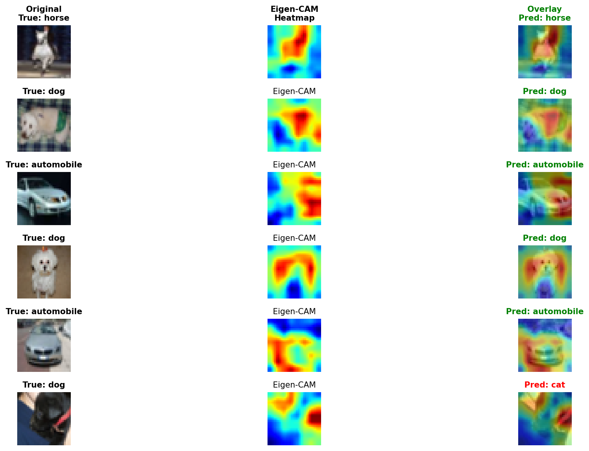
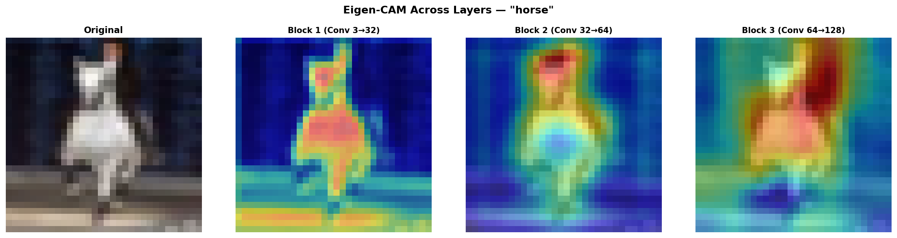
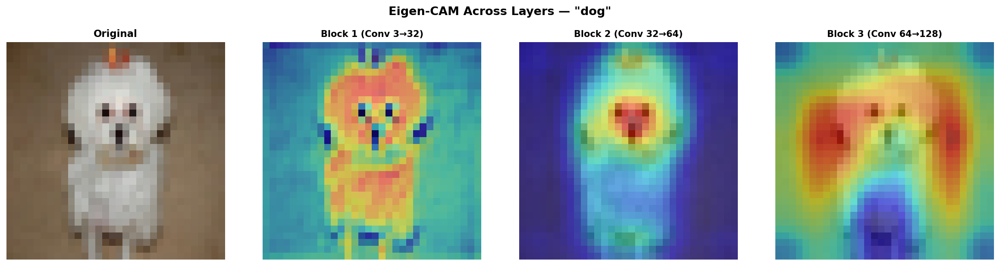
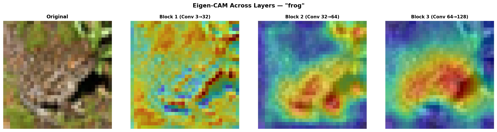

# 🔍 Eigen-CAM for CNN Explanations (CIFAR-10)

[](https://www.python.org/downloads/)
[](https://pytorch.org/)
[](LICENSE)

An implementation and evaluation of **Eigen-CAM** (*Class Activation Map using Principal Components*) for visual explainability in Convolutional Neural Networks on the CIFAR-10 dataset.

---

## 📌 Overview

Traditional Class Activation Mapping techniques (such as Grad-CAM) rely on gradient backpropagation with respect to specific class logits. In contrast, **Eigen-CAM** provides a **gradient-free and class-agnostic** approach:

1. **Feature Extraction**: Captures activation maps $A \in \mathbb{R}^{C \times H \times W}$ from a target convolutional layer.
2. **Matrix Reshaping**: Flattens spatial dimensions to form a 2D matrix $A \in \mathbb{R}^{C \times (H \cdot W)}$.
3. **Singular Value Decomposition (SVD)**:
   $$A = U \Sigma V^T$$
4. **Principal Spatial Pattern**: The first right-singular vector $V^T[0, :]$ corresponds to the principal component capturing the dominant spatial pattern attended to across all activation channels.
5. **Normalization & Interpolation**: Reshapes the vector back to $(H, W)$, normalizes values to $[0, 1]$, and bilinearly upsamples to the input image resolution.

### Key Advantages:
- ⚡ **Zero Backprop Required**: Completely avoids backpropagation, making it computationally faster.
- 🎯 **Gradient Independence**: Free from gradient saturation, vanishing gradients, or noise artifacts.
- 🔬 **Layer Agnostic**: Can be easily hooked onto any intermediate convolutional layer to visualize feature abstraction.

---

## 🖼️ Visual Results

### Saliency Map Overlays
Eigen-CAM highlights the key spatial regions that dominate the network's internal representations:



### Multi-Layer Representation Hierarchy
Comparing heatmaps across consecutive convolutional layers shows how early layers capture edges and low-level contours, while deeper layers isolate semantic object structures:

| Sample 1 | Sample 2 | Sample 3 |
|:---:|:---:|:---:|
|  |  |  |

---

## 🏗️ Architecture

A lightweight 3-block convolutional neural network (`SmallCNN`) designed for $32 \times 32$ RGB images:

```text
Input (3x32x32)
   │
   ├── ConvBlock 1: Conv2d(3 -> 32)  -> BatchNorm -> ReLU -> MaxPool2d (16x16)
   ├── ConvBlock 2: Conv2d(32 -> 64) -> BatchNorm -> ReLU -> MaxPool2d (8x8)
   └── ConvBlock 3: Conv2d(64 -> 128)-> BatchNorm -> ReLU -> MaxPool2d (4x4)  <-- Target Layer
   │
AdaptiveAvgPool2d(1x1) -> Dropout(0.3) -> Linear(128, 10) -> Output (10 classes)
```

---

## 🚀 Quick Start

### 1. Installation

Clone this repository and install requirements:

```bash
git clone https://github.com/mmd-jadidi/eigen-cam-cifar10.git
cd eigen-cam-cifar10
pip install -r requirements.txt
```

### 2. Run Interactive Demo

Launch Jupyter Notebook to explore the visualizations interactively:

```bash
jupyter notebook eigen_cam_demo.ipynb
```

### 3. Generate CAM via Python

```python
import torch
from model import SmallCNN
from eigen_cam import EigenCAM
from utils import overlay_heatmap, denormalize

# Load model and weights
model = SmallCNN()
checkpoint = torch.load("checkpoints/best_model.pth", map_location="cpu")
model.load_state_dict(checkpoint["model_state_dict"])
model.eval()

# Initialize Eigen-CAM on the last conv layer
target_layer = model.get_cam_target_layer()
cam_extractor = EigenCAM(model, target_layer)

# Generate heatmap for an input tensor (shape: 1, 3, 32, 32)
heatmap = cam_extractor.generate(input_tensor)
```

### 4. Train Model from Scratch

```bash
python train.py --epochs 20 --lr 0.001 --batch-size 128
```

---

## 📂 Project Structure

```text
├── checkpoints/
│   └── best_model.pth           # Pretrained model checkpoint
├── outputs/                     # Visual explanation plots
│   ├── eigen_cam_grid.png
│   ├── layer_comparison_*.png
│   └── per_class_eigen_cam.png
├── eigen_cam.py                 # SVD-based EigenCAM implementation
├── eigen_cam_demo.ipynb         # Interactive Jupyter demonstration
├── model.py                     # SmallCNN PyTorch model
├── train.py                     # Training & validation loop
├── utils.py                     # Visualization & denormalization utilities
├── requirements.txt             # Project dependencies
├── LICENSE                      # MIT License
└── README.md                    # Project documentation
```

---

## 📚 References

- **Eigen-CAM**: Muhammad, M. B., & Yeasin, M. (2020). *Eigen-CAM: Class Activation Map using Principal Components.* [arXiv:2008.00299](https://arxiv.org/abs/2008.00299).
- **CIFAR-10 Dataset**: Krizhevsky, A. (2009). *Learning Multiple Layers of Features from Tiny Images.*

---

## 📄 License

This project is licensed under the MIT License - see the [LICENSE](LICENSE) file for details.
